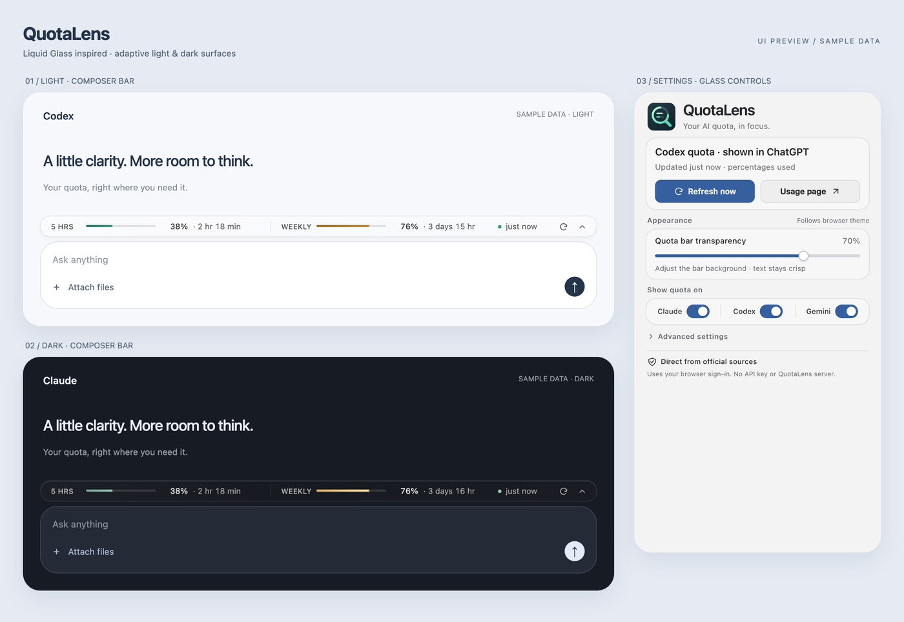
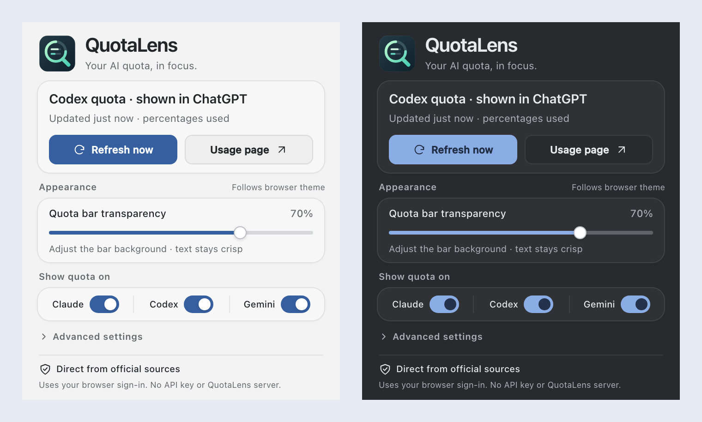

<p align="center">
  
</p>

<h1 align="center">QuotaLens</h1>
<p align="center">Your AI quota, in focus.</p>
<p align="center"><sub>Chrome 111+ · Manifest V3 · No Third-Party Server · MIT License</sub></p>
<p align="center"><a href="README.md">简体中文</a> · <strong>English</strong></p>

QuotaLens is a Chrome extension that displays **Claude, Codex, and Gemini 5-hour and weekly usage** directly above your chat input, allowing you to check remaining headroom and reset times before sending a message without opening settings.

<p align="center">
  
  <br />
  <sub>UI preview (rendered with local sample data): composer quota bars in light and dark modes alongside the settings popup</sub>
</p>

## Supported pages

| Page | Quota shown | Source |
| --- | --- | --- |
| Claude and Claude Code on the web | Claude 5h / 7d usage | Organization usage endpoint via your signed-in session |
| ChatGPT and Codex on the web | **Codex** 5h / 7d usage | Codex usage endpoint via your signed-in session |
| Gemini on the web | Gemini 5h / 7d usage | Direct request to the official usage RPC in the current page |

> **Note**: Claude usage is displayed only when a single chat-capable organization can be uniquely identified. Accounts belonging to multiple eligible organizations are directed to the official usage page.

## Install

Requires **Chrome 111 or later**. **Node.js, npm, and a build step are not required for installation**—the repository already includes pre-generated scripts and icons.

1. Download or clone the repository to a permanent local folder (keep the folder in place so Chrome can continue reading its files):
   - **Download ZIP**: click **Code → Download ZIP** in this repository and extract it;
   - **Git clone**:
     ```sh
     git clone git@github.com:zhidacaishu/QuotaLens.git
     ```
2. Open `chrome://extensions` in Chrome and enable **Developer mode**.
3. Click **Load unpacked** and select the repository root folder containing `manifest.json`.
4. Disable Usage Meter for Claude or older modified versions to avoid duplicate bars or UI conflicts.
5. Refresh your signed-in Claude, ChatGPT, or Gemini tab to activate.

## Controls

Click the QuotaLens icon in Chrome's toolbar to open the settings popup:

| Control | Description |
| --- | --- |
| **Refresh now** | Fetch the current platform's usage immediately (subject to server rate limits) |
| **Open Usage page** | Open the platform's official usage page to compare readings |
| **Quota bar transparency** | Adjust the quota bar background transparency (0–95%; text remains opaque) |
| **Show quota on: Claude / Codex / Gemini** | Toggle quota bar visibility per platform (enabled by default); the Codex toggle also applies to ChatGPT |
| **Advanced settings → Claude / Codex** | Configure the polling interval (minimum 10 seconds) |
| **Advanced settings → Gemini** | Configure the idle refresh interval (minimum 1 minute) |
| **Debug logging** | Enable diagnostic logging in the local console |

<p align="center">
  
  <br />
  <sub>Settings popup adapting to the browser's light and dark color schemes</sub>
</p>

**Bar interactions**:
- **Inline refresh**: Gemini provides an inline refresh button with busy feedback and rate-limit cooldown protection.
- **Status warnings**: Failed or stale readings retain a visible warning indicator in both compact and collapsed layouts; hover for details.
- **Collapse and expand**: Click the arrow on the bar to collapse it into a compact chip, and click the chip to expand.
- **Hover details**: Hover over a countdown to see the exact reset timestamp, or over the bar to view the quota source.

## Data, permissions, and privacy

See the full [Privacy Policy](PRIVACY.md).

- **Minimal permissions**: Requests only `storage` and access to supported Claude, ChatGPT, and Gemini domains. No all-site history, `cookies`, or `scripting` permissions are requested.
- **No third-party servers**: No telemetry, ads, or intermediary servers. All usage requests go directly to the respective official platform.
- **Transient credentials**: Session tokens and Gemini request verification parameters are used strictly at request time and are never persisted in extension storage, logged, or sent across execution-world messages.
- **In-memory readings**: Only user preferences and account-scoped Gemini RPC calibration identifiers are stored locally. Usage readings remain in page memory and are cleared when the tab closes; legacy Claude disk caches are removed at startup.
- **No conversation access**: No chat content is collected or uploaded. The extension observes composer geometry and response state solely to position and refresh the bar without modifying drafts.

> **Disclaimer**: Internal platform endpoints and page layouts are subject to change. QuotaLens is not affiliated with Anthropic, OpenAI, or Google. Implementation references and parsing boundaries are documented in [Data sources](docs/providers.md) (in Chinese).

## Development

```sh
npm ci
npm run build
npm run check
npm test
```

The extension runtime uses plain JavaScript with zero external runtime dependencies. Development dependencies include `jsdom` for unit and integration tests, `sharp` for exporting SVG assets to Chrome PNG icons, and `Playwright` for local Chromium layout and visual checks.

| Path | Purpose |
| --- | --- |
| `src/content.js` / `src/content.css` | Quota bar rendering, interactions, and state refresh |
| `src/layout.js` | Composer anchoring and overlap protection |
| `src/providers.js` | Platform detection and usage normalization |
| `src/gemini-*.js` | Gemini direct requests, execution-world bridge, and protocol parsing |
| `popup.html` / `popup.js` | Toolbar popup UI and settings management |
| `icons/quotalens.svg` | Vector icon source |
| `tests/` | Parsing, bridge, account isolation, and layout lifecycle tests |

**Build and icon export**:
- After editing Gemini `MAIN`-world or RPC helpers, run `npm run build` and commit the regenerated `src/gemini-main.bundle.js`.
- After editing the icon source, run `npm run build:icons` to re-export the 16 / 32 / 48 / 128px PNG assets.

**Testing and verification**:
Unit tests use mocked sessions and geometry, while Chromium checks exercise synthetic pages with intercepted local responses without signing in. For 0.1.6, signed-in Chrome checks compared ChatGPT and Gemini readings against their official usage pages and verified the Codex work toolbar and Gemini's narrow-screen mode switch; live Claude pages were outside the scope of that review. See [Testing](docs/testing.md) for commands and limitations.

## Acknowledgments

- **[Usage Meter for Claude](https://chromewebstore.google.com/detail/usage-meter-for-claude/jlohkbicmcebjejobahelcfbdmhjfdie)** ([source](https://github.com/suresh8883/Claude-Usage-Meter-Chrome-Extension)): Provided the inspiration for displaying quota directly above the composer, as well as reference implementations for Claude session-based usage fetching, progress display, and refresh behavior.
- **[Voyager](https://github.com/Nagi-ovo/voyager)**: Thank you for publishing the Gemini usage request and protocol parsing implementation, which informed the direct in-page request approach, account routing, and quota-window mapping. QuotaLens implements its own adapter from those references without temporary background tabs; referenced files and the pinned commit are listed in [Data sources](docs/providers.md).
- **Other references**: Thanks to [AI Usage](https://github.com/cupcakedev/ai-usage-extension) for its Codex browser-session approach, and [Gemini Web Quota Monitor](https://github.com/Hakkinex/Gemini_Web_Quota_Monitor) for inspiring the early adaptation.

## License

Released under the [MIT](LICENSE) License.
