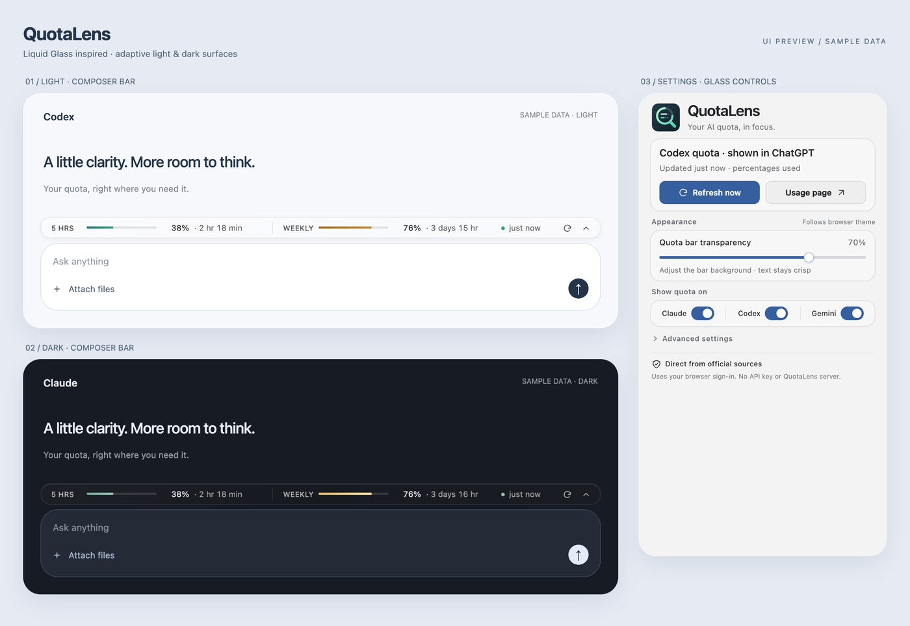
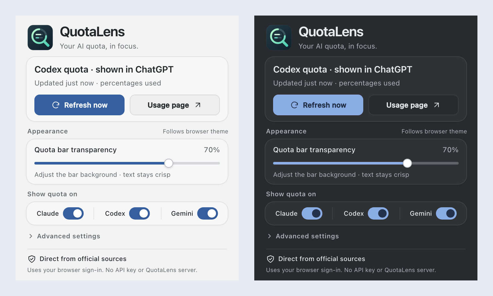

<p align="center">
  
</p>

<h1 align="center">QuotaLens</h1>
<p align="center">AI 额度，一眼看清。</p>
<p align="center"><sub>Chrome 111+ · Manifest V3 · 无第三方服务器 · MIT License</sub></p>
<p align="center"><strong>简体中文</strong> · <a href="README.en.md">English</a></p>

QuotaLens 是一款 Chrome 扩展，将 **Claude、Codex 与 Gemini 的 5 小时及每周已用额度**直接显示在聊天输入框上方，无需反复打开设置页即可查看当前用量与重置时间。

<p align="center">
  
  <br />
  <sub>界面预览（基于本地模拟数据渲染）：浅色与深色模式下的输入框上方额度栏及设置弹窗</sub>
</p>

## 支持平台与页面

| 平台 / 页面 | 显示内容 | 读取方式 |
| --- | --- | --- |
| Claude、Claude Code 网页版 | Claude 5h / 7d 已用额度 | 当前登录会话的组织用量接口 |
| ChatGPT、Codex 网页版 | **Codex** 5h / 7d 已用额度 | 当前登录会话的 Codex 用量接口 |
| Gemini 网页版 | Gemini 5h / 7d 已用额度 | 当前页面直接请求官方用量 RPC |

> **说明**：对于 Claude，扩展仅在当前登录账号可唯一确定具备聊天权限的组织时显示额度；若账号属于多个符合条件的组织，则会提示前往官方用量页核对。

## 安装

环境要求：**Chrome 111 或更高版本**。安装与日常使用**无需 Node.js、npm 或任何构建步骤**，仓库已包含可直接加载的完整脚本与图标。

1. 获取代码并保存至本地固定目录（请勿随意移动或删除该目录，以免 Chrome 无法继续读取扩展文件）：
   - **下载压缩包**：在 GitHub 页面点击 **Code → Download ZIP** 并解压；
   - **Git 克隆**：
     ```sh
     git clone git@github.com:zhidacaishu/QuotaLens.git
     ```
2. 在 Chrome 地址栏访问 `chrome://extensions`，开启右上角的**开发者模式**。
3. 点击**加载已解压的扩展程序**，选择代码库根目录（包含 `manifest.json` 的文件夹）。
4. 若此前已安装 Usage Meter for Claude 或类似扩展，请先停用，避免界面冲突或重复显示。
5. 刷新已登录的 Claude、ChatGPT 或 Gemini 页面即可生效。

## 使用与设置

点击 Chrome 工具栏中的 QuotaLens 图标即可打开设置弹窗：

| 控件 | 功能说明 |
| --- | --- |
| **Refresh now** | 立即刷新当前平台额度（仍受平台限流策略约束） |
| **Open Usage page** | 打开当前平台的官方用量页，便于对照核实 |
| **Quota bar transparency** | 调整额度栏背景透明度（0–95%，文字始终保持不透明） |
| **Show quota on: Claude / Codex / Gemini** | 分别控制各平台额度栏的显示（默认开启）；Codex 开关同时适用于 ChatGPT 页面 |
| **Advanced settings → Claude / Codex** | 设置额度轮询间隔（最低 10 秒） |
| **Advanced settings → Gemini** | 设置空闲状态下的刷新间隔（最低 1 分钟） |
| **Debug logging** | 开启调试日志，便于排查刷新异常 |

<p align="center">
  
  <br />
  <sub>设置弹窗跟随浏览器浅色与深色模式自适应显示</sub>
</p>

**界面交互**：
- **手动刷新**：Gemini 额度栏右侧提供手动刷新按钮；刷新期间防止重复请求，遇限流时显示等待倒计时。
- **状态提示**：刷新失败或读数过期时保留警示标记，悬停可查看具体原因；过期读数仅供参考。
- **折叠与展开**：点击额度栏右侧箭头可将其折叠为小标签，再次点击即可展开。
- **悬停信息**：鼠标悬停在倒计时上可查看具体重置时间；悬停在额度栏上可查看数据来源。

## 数据、权限与隐私

完整条款请参阅[隐私政策](PRIVACY.md)。

- **权限极简**：仅申请 `storage` 及目标站点的必要访问权限，不索取全站浏览历史、`cookies` 或 `scripting` 权限。
- **无第三方中转**：不含遥测、广告或第三方服务器，所有用量请求均直接发送至对应的官方平台。
- **凭证仅用于请求**：会话令牌与验证参数仅在发起请求时按需使用，不写入扩展存储、本地日志或跨运行环境消息。
- **数据留存内存**：除扩展设置及按账号隔离的 Gemini RPC 校准标识保存在本地外，额度读数仅暂存于当前页面内存中（关闭标签页即释放）；扩展启动时会自动清理旧版遗留的未绑定账号缓存。
- **不触碰对话内容**：不采集、不上传任何聊天内容。扩展仅读取输入框位置与回复生成状态以完成定位及刷新触发，不修改用户草稿。

> **免责声明**：各平台的网页内部接口与页面结构可能随官方更新而调整，本项目与 Anthropic、OpenAI、Google 无任何隶属关系。数据解析机制与边界约定详见[数据源说明](docs/providers.md)。

## 开发

```sh
npm ci
npm run build
npm run check
npm test
```

扩展运行时代码采用原生 JavaScript，无任何外部运行时依赖。开发依赖中，`jsdom` 用于运行单元与集成测试，`sharp` 用于将 SVG 矢量图导出为 Chrome 所需的 PNG 图标，`Playwright` 用于本地 Chromium 布局与视觉检查。

| 路径 | 说明 |
| --- | --- |
| `src/content.js` / `src/content.css` | 额度栏渲染、交互与状态刷新 |
| `src/layout.js` | 输入框定位与防遮挡保护 |
| `src/providers.js` | 平台识别与额度数据标准化 |
| `src/gemini-*.js` | Gemini 直连请求、跨环境桥接与协议解析 |
| `popup.html` / `popup.js` | 工具栏弹窗界面与设置管理 |
| `icons/quotalens.svg` | 矢量图标源文件 |
| `tests/` | 数据解析、消息桥接、账号隔离与布局生命周期测试 |

**构建与资源导出**：
- 修改 Gemini 的 `MAIN` 环境脚本或 RPC 辅助脚本后，需运行 `npm run build`，并一并提交重新生成的 `src/gemini-main.bundle.js`。
- 修改图标源文件后，可单独运行 `npm run build:icons`，重新导出 16 / 32 / 48 / 128px 规格的 PNG 图标。

**测试与验证**：
单元测试采用模拟会话与坐标数据；Chromium 布局检查基于无需登录的合成测试页面与本地拦截响应。在 0.1.6 版本中，已在登录的 Chrome 中对照 ChatGPT 与 Gemini 官方用量页核实读数，并验证 Codex 工作模式及 Gemini 窄屏模式切换；该轮实测跳过了 Claude 页面。详细运行方法与验证边界请参阅[测试说明](docs/testing.md)。

## 致谢

- **[Usage Meter for Claude](https://chromewebstore.google.com/detail/usage-meter-for-claude/jlohkbicmcebjejobahelcfbdmhjfdie)**（[源码](https://github.com/suresh8883/Claude-Usage-Meter-Chrome-Extension)）：提供了在输入框上方展示额度的交互构想，以及 Claude 会话读取、进度展示与刷新机制的实现参考。
- **[Voyager](https://github.com/Nagi-ovo/voyager)**：感谢其开源 Gemini 用量请求与协议解析实现，为直接在当前页面读取额度、账号路由及周期字段映射提供了关键参考。QuotaLens 据此独立编写了适配器，无需创建临时后台标签页（详见[数据源说明](docs/providers.md)）。
- **其他参考**：感谢 [AI Usage](https://github.com/cupcakedev/ai-usage-extension) 提供的 Codex 会话读取思路，以及 [Gemini Web Quota Monitor](https://github.com/Hakkinex/Gemini_Web_Quota_Monitor) 对早期适配方案的启发。

## 许可协议

本项目基于 [MIT](LICENSE) 许可协议发布。
